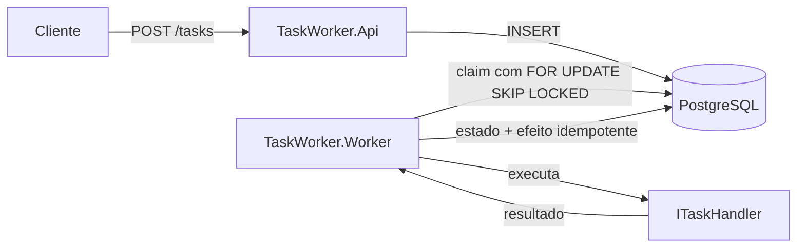
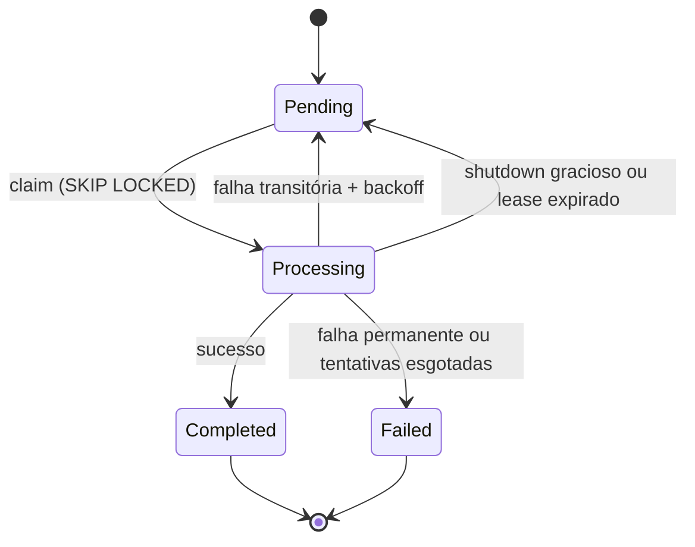

# TaskWorker — Processamento assíncrono de tarefas

Worker Service independente que processa tarefas demoradas em background, com fila
persistida no PostgreSQL, aquisição concorrente segura, retentativas com backoff e
encerramento gracioso.

> **Status:** versão base em PostgreSQL implementada e coberta por testes.
> RabbitMQ permanece como evolução opcional.

## Stack

- **.NET 10 (LTS)** — Worker Service (`BackgroundService`) e API Minimal
- **PostgreSQL 17** com **EF Core 10 + Npgsql**
- **Serilog** com logs estruturados em JSON compacto
- **xUnit** para testes unitários e de integração
- **Testcontainers** para testes com PostgreSQL real
- **Docker Compose** e **GitHub Actions**

## Arquitetura



O worker e a API são processos independentes. A API apenas persiste tarefas; o worker
faz polling em lotes e processa cada tarefa isoladamente.

## Ciclo de vida da tarefa

| Estado persistido | Equivalente no README | Significado |
| --- | --- | --- |
| `Pending` | Pendente | Aguardando processamento ou nova tentativa |
| `Processing` | EmProcessamento | Adquirida por um worker com lease ativo |
| `Completed` | Concluída | Processada com sucesso; efeito persistido uma única vez |
| `Failed` | FalhaDefinitiva | Falha permanente ou limite de tentativas esgotado |



Falhas desconhecidas são tratadas como transitórias e limitadas por `maxAttempts`.
Falhas permanentes devem ser sinalizadas pelo handler com `PermanentTaskException`.
Falhas transitórias usam `TransientTaskException`.

## Estrutura

```text
src/
  TaskWorker.Core/            Domínio, estados, contrato de handler, backoff
  TaskWorker.Infrastructure/  EF Core, migrations, fila e efeitos idempotentes
  TaskWorker.Worker/          Loop de processamento, handler demo, logs
  TaskWorker.Api/             Minimal API para criar/consultar tarefas
tests/
  TaskWorker.UnitTests/       Backoff, registry e handler demo
  TaskWorker.IntegrationTests/ PostgreSQL real via Testcontainers
```

## Como executar com Docker

Pré-requisitos: Docker com Compose.

```bash
docker compose up -d --build
```

Serviços:

- API: `http://localhost:8080`
- PostgreSQL: `localhost:5432` (credenciais locais de demonstração)

As migrations são aplicadas automaticamente na inicialização (API e worker usam um
advisory lock do PostgreSQL para evitar execução concorrente).

### Criar e acompanhar uma tarefa

```bash
curl -s -X POST http://localhost:8080/tasks \
  -H "Content-Type: application/json" \
  -d '{"type":"demo","payload":{"message":"hello","delayMs":300},"idempotencyKey":"demo-1"}'

curl -s http://localhost:8080/tasks/<id>
```

Exemplo de resposta após a conclusão:

```json
{
  "id": "468f9ef0-9b6a-444f-bb56-b5c8ed95100a",
  "type": "demo",
  "state": "Completed",
  "attempts": 1,
  "maxAttempts": 3,
  "lastError": null,
  "idempotencyKey": "demo-1",
  "createdAt": "2026-10-28T19:58:28.775411+00:00",
  "updatedAt": "2026-10-28T19:58:30.676811+00:00",
  "nextAttemptAt": null,
  "finishedAt": "2026-10-28T19:58:30.676811+00:00"
}
```

Reenviar a mesma `idempotencyKey` retorna a tarefa existente com HTTP 200 (a criação
inicial retorna 201).

### Cenários de falha demonstráveis

```bash
# Falha transitória: falha na 1ª tentativa e conclui na 2ª (backoff de 2s)
curl -s -X POST http://localhost:8080/tasks -H "Content-Type: application/json" \
  -d '{"type":"demo","payload":{"behavior":"transient","failUntilAttempt":1},"maxAttempts":3}'

# Falha permanente: vai direto para Failed
curl -s -X POST http://localhost:8080/tasks -H "Content-Type: application/json" \
  -d '{"type":"demo","payload":{"behavior":"permanent"},"maxAttempts":3}'

# Tipo sem handler: também termina em Failed
curl -s -X POST http://localhost:8080/tasks -H "Content-Type: application/json" \
  -d '{"type":"tipo-inexistente","payload":{}}'
```

O handler `demo` aceita:

| Campo | Descrição |
| --- | --- |
| `message` | Texto devolvido no efeito |
| `delayMs` | Simula trabalho demorado (0 a 60000); respeita cancelamento |
| `behavior` | `success`, `transient` ou `permanent` |
| `failUntilAttempt` | Para `transient`, falha enquanto a tentativa for menor ou igual a este valor |

### Logs

```bash
docker compose logs -f worker
```

Cada linha é um JSON estruturado com `TaskId`, `State`, `DurationMs`,
`FailureReason`, `Attempt`, `WorkerId` e timestamps. Payloads não são registrados.

### Parar

```bash
docker compose down
docker compose down -v   # remove também o volume do PostgreSQL
```

## Execução local (sem container para a API/worker)

Pré-requisitos: .NET 10 SDK, Docker e `dotnet-ef` (via tool manifest).

```bash
docker compose up -d postgres
dotnet tool restore

export ConnectionStrings__Postgres="Host=localhost;Port=5432;Database=taskworker;Username=taskworker;Password=taskworker_dev"

dotnet run --project src/TaskWorker.Worker
dotnet run --project src/TaskWorker.Api
```

No PowerShell:

```powershell
$env:ConnectionStrings__Postgres = "Host=localhost;Port=5432;Database=taskworker;Username=taskworker;Password=taskworker_dev"
dotnet run --project src/TaskWorker.Worker
```

A API usa `ASPNETCORE_URLS`; no perfil local padrão ela responde em
`http://localhost:5116`. As migrations rodam automaticamente ao iniciar.

## API

| Método | Rota | Descrição |
| --- | --- | --- |
| `POST` | `/tasks` | Cria uma tarefa; aceita `type`, `payload`, `maxAttempts` e `idempotencyKey` |
| `GET` | `/tasks/{id}` | Consulta estado, tentativas, erro mais recente e timestamps |
| `GET` | `/health` | Verifica conectividade com o PostgreSQL |

Regras de criação: `type` obrigatório (até 100 caracteres), `maxAttempts` entre 1 e 20
(padrão 3), payload de até 64 KB e `idempotencyKey` de até 200 caracteres.

## Configuração do worker

`Worker` em `appsettings.json` (ou variáveis `Worker__*`):

| Opção | Padrão | Descrição |
| --- | --- | --- |
| `BatchSize` | `10` | Tarefas adquiridas por lote |
| `PollInterval` | `00:00:01` | Intervalo de polling quando a fila está vazia |
| `LeaseTimeout` | `00:02:00` | Tempo até um lease ser considerado expirado |
| `LeaseRenewalInterval` | `00:00:30` | Heartbeat de renovação do lease (deve ser menor que o timeout) |
| `LeaseRecoveryInterval` | `00:00:30` | Frequência de recuperação de leases expirados |
| `Retry:BaseDelay` | `00:00:02` | Delay da primeira retentativa |
| `Retry:MaxDelay` | `00:01:00` | Teto do backoff exponencial |

O backoff é `BaseDelay × 2^(tentativa-1)`, limitado por `MaxDelay`.

## Testes

```bash
dotnet test
```

- 22 testes unitários (backoff, registry, handler demo e modelo)
- 10 testes de integração com PostgreSQL real (Testcontainers)
- Cenários cobertos: conclusão, falha isolada, retentativa, esgotamento de tentativas,
  falha permanente, concorrência entre dois workers reais, renovação de lease,
  recuperação de lease expirado, shutdown gracioso, idempotência de criação e de efeito.

Os testes de integração exigem Docker em execução. A CI executa a suíte completa em
`.github/workflows/ci.yml`.

## Decisões técnicas

- **Aquisição segura:** `UPDATE ... FROM (SELECT ... FOR UPDATE SKIP LOCKED)` em uma única
  instrução. Dois workers não recebem a mesma linha, sem lock global da fila.
- **Lease com heartbeat:** o worker renova o lease enquanto processa. Tarefas longas não
  são roubadas por outro worker. Se o worker morrer, o lease expira e a tarefa volta para
  `Pending`.
- **Encerramento gracioso:** `CancellationToken` percorre handler, renovação de lease e
  logs. Tarefas interrompidas voltam a `Pending` e a tentativa é desfeita; o lease expirado
  mantém a tentativa para evitar loops infinitos de crash.
- **Idempotência:** o efeito é gravado em `task_effects` com PK `task_id` e
  `ON CONFLICT DO NOTHING` na mesma transação da conclusão. Reprocessar não duplica o
  efeito. A API também deduplica criação por `idempotency_key` (índice único parcial).
- **Persistência de falha:** o worker armazena erro mais recente, número de tentativas,
  `next_attempt_at` e `finished_at`. Falhas permanentes vão direto para `Failed`.
- **Serilog:** JSON compacto, propriedades estruturadas e sem payload/dados sensíveis.
- **Migrations:** aplicadas no startup sob advisory lock; segredos apenas via variáveis
  de ambiente/`appsettings` externos.

## Limitações conhecidas

- A API não possui autenticação/autorização; o projeto é uma demonstração local.
- O handler `demo` é o único handler embutido; handlers reais devem ser registrados como
  `ITaskHandler`.
- A idempotência garante um único efeito persistido pelo framework. Efeitos externos
  dentro de um handler (e-mail, cobrança etc.) devem usar `TaskId` como chave idempotente.
- Não há endpoint de listagem, cancelamento ou reprocessamento manual de tarefas.
- O resultado do handler é armazenado em texto; não registre segredos nele.
- RabbitMQ, dead-letter queue e acknowledgements não foram implementados nesta versão.
- Migrations automáticas no startup são adequadas para a demonstração; em produção,
  prefira um passo de deploy dedicado.

## Próxima evolução opcional

RabbitMQ pode ser adicionado após a versão PostgreSQL estar estável, com publicação de
tarefas, acknowledgements, retentativas, dead-letter queue e consumidores idempotentes.
Kafka está fora do escopo deste projeto.
